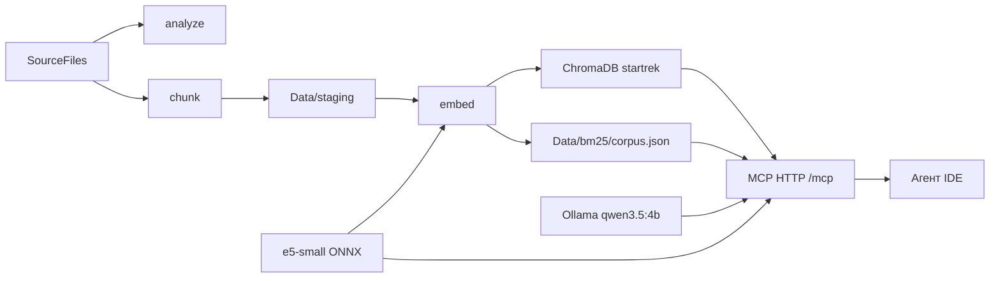
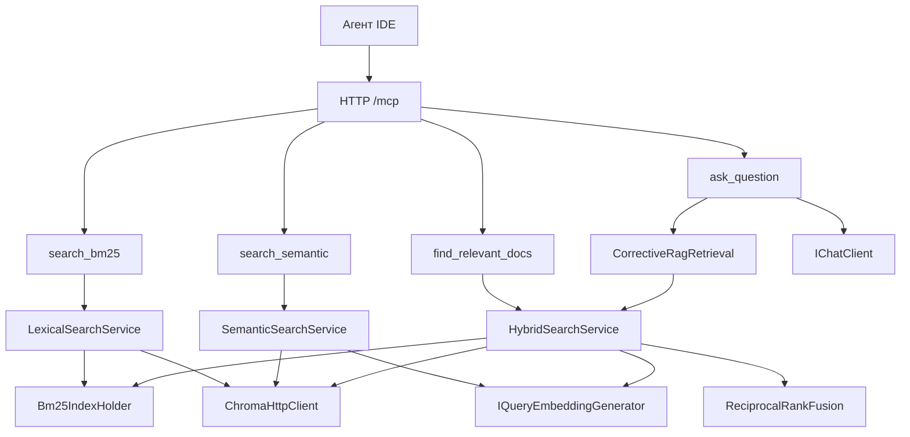
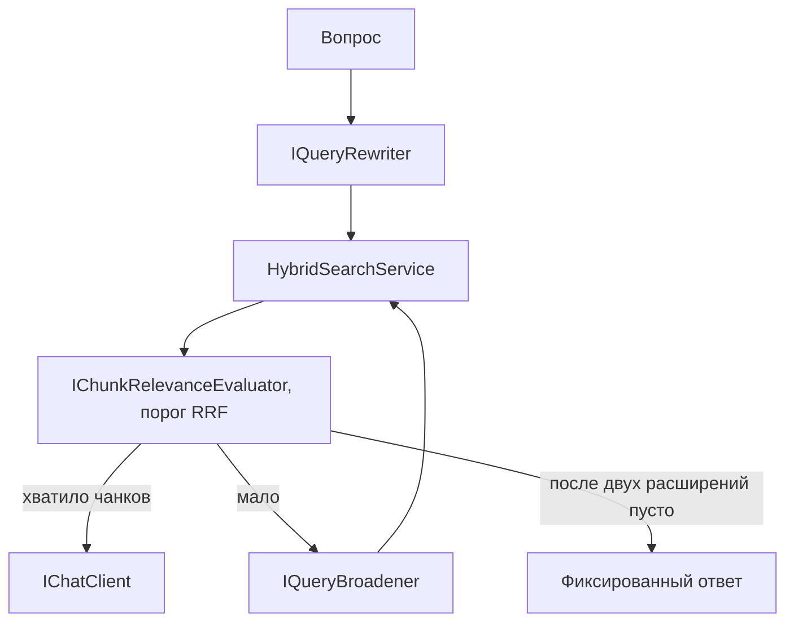

# Архитектура

Поисковая база по русскоязычному корпусу Star Trek. Два процесса на C# / .NET 10: консольный индексатор готовит чанки и два индекса, HTTP-сервер Model Context Protocol отдаёт агенту IDE три поиска по чанкам и ответ инструмента `ask_question`. Поиски возвращают чанки по фразе аргумента `query`. `ask_question` вызывает уже собранный в индексаторе `CorrectiveRagRetrieval`: переписывание вопроса, гибридный поиск и до двух расширений запроса. Релевантность — порог оценки RRF за `IChunkRelevanceEvaluator`. Ответ пишет тот же `IChatClient` Ollama, только по чанкам не ниже порога.

Исходное задание описывало Python, FastMCP, LangGraph и Ollama. В этом репозитории тот же контур собран иначе: нарезка и эмбеддинги — в `StarTrek.Indexer`, поиск и ответ — инструменты MCP. Обоснование — в [Docs/6. Plan.md](Docs/6.%20Plan.md) и [Docs/8. Спецификация MCP-сервера.md](Docs/8.%20Спецификация%20MCP-сервера.md). Запуск — в [README.md](README.md).

## Состав

| Часть | Где | Роль |
|---|---|---|
| Индексатор | `src/StarTrek.Indexer` | Читает `SourceFiles`, режет по заголовкам, считает векторы, пишет ChromaDB и корпус BM25 |
| MCP-сервер | `src/StarTrek.Mcp` | Слушает Streamable HTTP и отдаёт три поиска и `ask_question`. Ссылается на индексатор, своей копии поиска не держит |
| Векторное хранилище | контейнер ChromaDB, том `./ChromaDB` | Коллекция `startrek`, 384 измерения |
| Чат | контейнер Ollama, модель `qwen3.5:4b` | Переписывает и расширяет запрос в индексаторе и пишет ответ `ask_question` |
| Разреженный индекс | `Data/bm25/corpus.json` | Id чанка и токены Okapi BM25. Текст чанка там не хранится |
| Черновик нарезки | `Data/staging/` | JSON документов без векторов |
| Корпус | `SourceFiles/` | Расы, планеты, корабли, сериалы |
| Тесты | `Tests/StarTrek.Indexer.Tests`, `Tests/StarTrek.Mcp.Tests` | Нарезка, эмбеддинги, поиск, инструменты MCP |

Контракт `IEmbeddingGenerator` берётся из `Microsoft.Extensions.AI`. Чат с локальной моделью идёт через `IChatClient` библиотеки OllamaSharp. Секция `Llm`, модель по умолчанию `qwen3.5:4b`. Переписывание, расширение и ответ — прямые вызовы того же клиента, оценка чанка — порог RRF.

## Потоки



Индексатор и сервер — разные процессы. `docker compose up` корпус не индексирует: сервис `indexer` выполняет `health-check` и завершается, сервис `mcp` только читает уже собранные индексы.

Сервер не пишет в `SourceFiles`, `Data/staging`, `Data/bm25` и в коллекцию. Папку `ChromaDB` он не открывает: коллекция читается по HTTP API. Единственная запись сервера на диск — журнал в `Data/Logs`.

## Индексатор

Точка входа — `StarTrek.Indexer.Program`. Корень репозитория ищется вверх от текущей папки и от каталога сборки, пока не найдётся `MCP.RAG.StarTrek.sln`. Относительные пути из настроек считаются от этого корня.

| Команда | Читает | Пишет |
|---|---|---|
| `analyze` | `SourceFiles` | Ничего. Печатает отчёт: файлы, уровни заголовков, пустые блоки, разделы длиннее 480 и короче 80 токенов |
| `chunk` | `SourceFiles`, `tokenizer.json` | JSON в `Data/staging/`. Файл с тем же `content_hash` пропускает. В ChromaDB не пишет |
| `embed` | `Data/staging/`, `model.onnx`, API ChromaDB | Upsert в коллекцию `startrek`, пересборка `Data/bm25/corpus.json` |
| `health-check` | Ничего из корпуса | Печатает `Индексатор отвечает: healthy.` |
| `help` | Ничего | Список команд |

`analyze`, `chunk` и `health-check` работают без `model.onnx`. Если при `embed` нет модели или ChromaDB не отвечает, команда останавливается и уже записанное не трогает.

Пространства имён индексатора:

| Пространство | Что делает |
|---|---|
| `Parsing` | Три диалекта заголовков, нормализация Unicode NFC и переводов строк `\n` |
| `Chunking` | Разделы, потолок 480 токенов, перенос предложений, JSON подготовки |
| `Tokenization` | Токенизатор e5 и текст, который уходит в модель |
| `Embeddings` | ONNX Runtime, mean pooling, L2-нормализация, префиксы `passage: ` и `query: ` |
| `Chroma` | HTTP-клиент коллекции `startrek` |
| `Bm25` | Okapi BM25, токенизатор, файл корпуса, держатель индекса в памяти |
| `Search` | Смысловой поиск, поиск по словам, слияние RRF |
| `Rag` | Переписывание вопроса и передача запроса в гибридный поиск |
| `Commands` | `analyze`, `chunk`, `embed`, `health-check`, `help` |
| `Configuration` | `appsettings.json`, переменные `STARTREK_`, регистрация служб |

Команды индексации регистрирует `AddStarTrekIndexer`. Сервер эту регистрацию не подключает: она поднимает команды записи и при первом обращении к генератору требует `model.onnx`. Для чтения сервер вызывает `AddStarTrekSearchRead`: клиент ChromaDB, держатель BM25, три поиска и ленивый генератор запроса. ONNX создаётся внутри смыслового или гибридного вызова, а не при старте слушателя.

## Нарезка

Граница чанка — строка из одних решёток либо решётки и заголовок на той же строке. Родительский и дочерний чанк не делаются: один и тот же фрагмент ищется и отдаётся клиенту.

В `SourceFiles` три диалекта заголовков:

- расы — строка из одних `####`, заголовок следующей строкой;
- планеты и сериалы — Markdown `#` на той же строке;
- корабли — `#` реестр, `##` класс, `###` корабль.

Шапка файла (`# Название` и строка оригинального названия) становится полями документа, а не пустым чанком. Текст до первого содержательного заголовка — отдельный вводный чанк. Стек заголовков дописывает более глубокий уровень в путь и закрывает раздел на том же или более высоком уровне.

Раздел длиннее 480 токенов делится по пустой строке, затем по предложению. В следующий кусок переносятся одно-два последних предложения, в пределах 120 токенов. Окно модели — 512, поэтому хвост чанка остаётся внутри вектора. Раздел короче 80 токенов остаётся отдельным чанком: соседние корабли и факты через границу решёток не склеиваются.

Токены считает `tokenizer.json` модели e5. Имена, номера кораблей и коды серий не переписываются. Символы `#` в текст эмбеддинга не попадают: путь раздела пишется словами.

Текст, который видит модель:

```text
Документ: Талосианцы
Тип сущности: раса
Раздел: История

<абзацы раздела>
```

В коллекцию уходит этот текст без префикса `passage: `. Префикс добавляется только на время вызова энкодера. Запросу генератор добавляет `query: `.

Идентификатор документа — SHA-256 пути (NFC, нижний регистр, `\` заменён на `/`). `content_hash` — SHA-256 нормализованного текста файла. Идентификатор чанка — `document_id:chunk_index`. Если хеш файла изменился, старые id этой карточки удаляются и записываются заново.

## Эмбеддинги

Модель — `intfloat/multilingual-e5-small`, ONNX, 384 измерения. Считает `OnnxE5EmbeddingGenerator` через ONNX Runtime: mean pooling по `last_hidden_state` и L2-нормализация. Платный API не вызывается.

`tokenizer.json` лежит в git. `model.onnx` (~448 МБ) скачивается отдельно в `Models/multilingual-e5-small/` и в образ Docker не входит. Образ монтирует эту папку с хоста только для чтения.

## Хранилища

ChromaDB — образ `chromadb/chroma:1.5.9`, порт `8000`, том `./ChromaDB:/data`. Путь `/data` внутри контейнера задаёт образ, его не переименовывают. C# пишет и читает коллекцию только по HTTP: локально `http://127.0.0.1:8000`, в Compose — `http://chromadb:8000`.

У записи коллекции плоские metadata. Вложенные объекты ChromaDB не принимает.

| Поле | Смысл |
|---|---|
| `document_id`, `content_hash` | Карточка файла и признак, что текст не менялся |
| `source_file`, `file_type`, `title`, `original_title` | Источник и названия |
| `entity_type` | `race`, `planet`, `starship`, `series`, `other` по папке |
| `franchise`, `language` | `Star Trek`, `ru` |
| `chunk_index`, `heading_level`, `start_line`, `end_line`, `token_count` | Место фрагмента |
| `section_title`, `section_path` | Путь раздела одной строкой через ` > ` |
| `position` | Строка вида `lines 12-40` |
| `embedding_model` | `intfloat/multilingual-e5-small` |

`source` и `position` из задания — это `source_file` и `position`.

Корпус BM25 хранит id и токены. При старте поиска `Bm25IndexHolder` поднимает его в память. Токен — слово из букв и цифр в нижнем регистре. Код с цифрой и дефисами остаётся одним токеном (`NCC-1701-D`). Слово с дефисом и без цифры режется. Коэффициенты: `k1 = 1.5`, `b = 0.75`.

## MCP-сервер

Проект `StarTrek.Mcp` — приложение ASP.NET Core без страниц и контроллеров. Транспорт — Streamable HTTP, сессии stateless, путь `/mcp`, адрес `http://0.0.0.0:8080`. Для клиента на этой машине — `http://127.0.0.1:8080/mcp`. STDIO и устаревший SSE не включаются. Пример подключения агента — `mcp.example.json`.

`GET /health` отвечает `MCP-сервер отвечает: healthy.` и не читает индексы. Слушатель поднимается и без `model.onnx`, без корпуса BM25 и без ответа ChromaDB. Отсутствие индекса сообщает тот инструмент, который им пользуется.

Инструменты помечены `[McpServerTool]`. Описание на русском говорит агенту, когда вызывать каждый из них. Инструменты только читают индекс.



| Инструмент | Канал | Оценка в ответе |
|---|---|---|
| `search_bm25` | Токены запроса в Okapi BM25, текст чанка дочитывается из ChromaDB по id | `bm25Score`, больше — ближе |
| `search_semantic` | Вектор запроса, `limit` ближайших соседей коллекции `startrek` | `distance`, для косинусной коллекции это `1 − сходство`, меньше — ближе |
| `find_relevant_docs` | Оба списка, затем Reciprocal Rank Fusion | `rrfScore`, больше — выше. Рядом ранги и оценки каналов, если чанк в них был |
| `ask_question` | Corrective RAG по вопросу, ответ только по чанкам с оценкой RRF не ниже порога | Текст ответа, `sources` (файл и позиция), `meta` (итоговый запрос и число попыток) |

У трёх поисков общий обязательный `query` и необязательное число результатов. У `search_bm25` и `search_semantic` оно называется `limit`, у `find_relevant_docs` — `top_k`. Пустой запрос — ошибка инструмента, поиск не вызывается. Нет этого параметра — берётся `Indexer:Search:ResultCount` (10). Меньше 1 приводится к 1, больше 20 — к 20. Успешный ответ с нулём чанков значит, что совпадений нет. Ошибка называет, чего не хватает: модель, корпус BM25, коллекция или адрес ChromaDB. Исключение наружу процесс не валит. `ask_question` принимает один аргумент `question`. Пустой вопрос — ошибка инструмента.

У `search_bm25` запрос без токенов — ошибка. У `find_relevant_docs` в этом случае канал BM25 пуст, векторный канал всё равно выполняется.

Поля чанка в ответе: `id`, `text`, оценки своего инструмента, `sourceFile`, `title`, `originalTitle`, `entityType`, `sectionPath`, `position`, `chunkIndex`. Нет ключа в metadata — поля нет, пустая строка не подставляется.

Журнал — `ILogger` и файлы GELF через NLog, уровень `Debug`. Старт хоста пишется в `Data/Logs/mcp-init.log`, вызовы инструментов — в `Data/Logs/mcp-requests.log` (входящие `query` или `question` и `limit` либо `top_k`, исходящий список чанков, ответ или текст ошибки). `GET /health` в журнал запросов не попадает. Канал логирования протокола MCP не включается.

## Слияние RRF

`HybridSearchService` считает вектор запроса, берёт `VectorTopN` соседей ChromaDB и `Bm25TopN` попаданий BM25 (оба порога сейчас 20), затем сливает списки:

```text
score(id) = Σ 1 / (k + rank)
```

`rank` считается с 1, `k` — `Indexer:Search:RrfK` (60). Повтор id внутри одного списка учитывается один раз, по первой позиции. Порядок результата: оценка по убыванию, затем лучший ранг, затем id. Чанк, который есть только в одном списке, остаётся в выдаче со вкладом этого списка. Id из старого корпуса BM25, которого уже нет в коллекции, отбрасывается. Клиенту возвращается не больше запрошенного числа чанков: у `find_relevant_docs` это `top_k`.

## Corrective RAG и ask_question

`ask_question` не ищет сам. Он вызывает `CorrectiveRagRetrieval`, оставляет чанки с оценкой не ниже порога и пишет ответ тем же `IChatClient`.



`IQueryRewriter` спрашивает Ollama и при пустом ответе, ошибке или таймауте оставляет исходный вопрос. Если релевантных чанков меньше `Rag:MinRelevantChunks`, `IQueryBroadener` расширяет запрос и поиск повторяется, не больше `MaxBroadenAttempts` раз. Релевантный чанк — тот, чья оценка RRF не ниже `Rag:MinRrfScore`. Если таких чанков с текстом не осталось, модель для ответа не вызывается: возвращается «В базе знаний Star Trek об этом ничего не найдено.» Если чанки остались, ответ пишется только по ним, с файлом и позицией. Ошибка Ollama на шаге ответа и ошибка ChromaDB приходят текстом инструмента, процесс не падает.

## Конфигурация

Пороги и пути индекса — в `src/StarTrek.Indexer/appsettings.json`. Адрес MCP, путь `/mcp` и файлы журнала — в `src/StarTrek.Mcp/appsettings.json`. Второй копии порогов BM25, адреса Chroma и путей корпуса в проекте сервера нет: сервер читает файл индексатора.

Переменные окружения с префиксом `STARTREK_` перекрывают оба файла. Вложенный ключ пишется через `__`, например `STARTREK_Indexer__Chroma__Endpoint`.

| Секция | Что задаёт |
|---|---|
| `Indexer:Paths` | Корпус, подготовка, папка модели, файл BM25 |
| `Indexer:Chroma` | Адрес, коллекция `startrek`, tenant и database |
| `Indexer:Chunking` | 480 / 80 / 512 токенов и перенос между кусками |
| `Indexer:Bm25` | `K1 = 1.5`, `B = 0.75` |
| `Indexer:Search` | `RrfK = 60`, по 20 кандидатов с канала, 10 в ответе по умолчанию |
| `Mcp` | Путь, адрес слушателя, уровень и файлы журнала |
| `Llm` | Адрес Ollama, тег модели (`qwen3.5:4b`), температура, таймаут |
| `Rag` | `MinRelevantChunks = 2`, `MaxBroadenAttempts = 2`, временный порог `MinRrfScore` |

## Docker Compose

| Сервис | Образ | Что делает |
|---|---|---|
| `chromadb` | `chromadb/chroma:1.5.9` | API на порту 8000, данные в `./ChromaDB` |
| `indexer` | `startrek-indexer`, `Dockerfile` | По умолчанию `health-check` |
| `mcp` | `startrek-mcp`, `Dockerfile.mcp` | Слушает 8080. Монтирует корпус BM25 и папку модели только для чтения, журнал — на запись. `STARTREK_Llm__Endpoint=http://ollama:11434`, `STARTREK_Llm__Model=qwen3.5:4b` |
| `ollama` | `ollama/ollama:latest` | API чата на порту 11434, том `ollama-models` |
| `ollama-pull` | `ollama/ollama:latest` | Один раз скачивает `qwen3.5:4b` и завершается |

В Compose адрес ChromaDB для обоих процессов — `http://chromadb:8000`. Адрес Ollama для `mcp` — `http://ollama:11434`.

## Граница этого репозитория

Собраны нарезка, локальные эмбеддинги, запись в ChromaDB, корпус BM25, три поисковых инструмента MCP и `ask_question`.

Три поиска отдают чанки по фразе аргумента `query`. `ask_question` отвечает через `CorrectiveRagRetrieval` и `IChatClient`: переписывание, гибридный поиск, порог RRF и до двух расширений запроса остаются в индексаторе. Папку индексирует консоль `embed`, статистику индекса `index_status` сервер не отдаёт.
