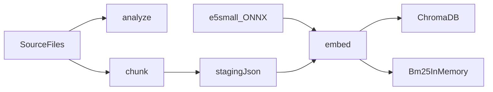

# Эмбеддинги, ChromaDB и нарезка чанков

Весь проект — C# и .NET 10. Python-проектов в решении нет. Оркестрация поиска позже строится на Microsoft Semantic Kernel, не на LangGraph и не на LangChain. Локальная генеративная LLM для нарезки не нужна: границы чанков уже стоят в файлах решётками.

## 1. Модель эмбеддингов

Выбор: **`intfloat/multilingual-e5-small`**.

- 384 измерения, окно 512 токенов, русский язык, локально, без платного API.
- ТЗ не назначает обязательную модель. Для этого корпуса приоритет ТЗ — локальные эмбеддинги, гибридный поиск и чанк, который целиком входит в окно модели. Это закрывает [0. ТЗ. project_Corrective_RAG_MCP-248024-92e22a.md](0.%20ТЗ.%20project_Corrective_RAG_MCP-248024-92e22a.md) и [4. Рекомендуемая стратегия по разбивке чанков по ТЗ.md](4.%20Рекомендуемая%20стратегия%20по%20разбивке%20чанков%20по%20ТЗ.md).
- В ChromaDB у каждой записи есть поле эмбеддинга. Его длина — 384, по размеру этой модели. Рекомендация PostgreSQL из [3. Рекомендуемая база данных.md](3.%20Рекомендуемая%20база%20данных.md) в проект не входит.
- Потолок 512 токенов важнее желаемых 650–1000 из [2. Рекомендуемая стратегия по разбивке чанков от ИИ.md](2.%20Рекомендуемая%20стратегия%20по%20разбивке%20чанков%20от%20ИИ.md). Иначе хвост чанка не попадёт в вектор.
- В текст эмбеддинга добавляется префикс `passage: `. В вопрос позже — `query: `. В ChromaDB хранится текст без этого служебного префикса.
- Символы `#` в эмбеддинг не передаются. Путь раздела пишется словами.

Родительский и дочерний чанк не делаем. Поиск, оценка и ответ работают с одним и тем же чанком.

Считается энкодер через ONNX Runtime и регистрируется в Semantic Kernel как локальный генератор эмбеддингов. Чат-модель для этого не вызывается.

## 2. Хранилище ChromaDB

Исходники остаются в `SourceFiles`. Векторы и текст чанков лежат в одной коллекции ChromaDB `startrek`. Отдельной SQL-базы и скрипта таблиц нет.

Файлы коллекции лежат в папке проекта [ChromaDB](../ChromaDB). Это диск хранилища, не исходный код. Docker Compose монтирует эту папку в контейнер и публикует порт 8000.

Примечание. Для C# пакет `Microsoft.SemanticKernel.Connectors.Chroma` не умеет писать в папку `ChromaDB` напрямую. Отдельного пакета `Microsoft.SemanticKernel.Connectors.ChromaDB` нет: в NuGet хранилище называется Chroma, в этом плане и в ТЗ — ChromaDB. Чтобы записать чанки этим пакетом, ChromaDB должна быть запущена и отвечать по адресу `http://127.0.0.1:8000`. Это не сайт в интернете. Это локальный API хранилища на этом же компьютере: консоль отправляет туда команды «запиши чанк» и «найди ближайшие». Docker Compose как раз публикует этот порт.

Консоль контейнер сама не запускает. Если по адресу никто не отвечает, команда `embed` останавливается и сообщает, что ChromaDB не запущена. Код нарезки, эмбеддингов и запросов остаётся только на C#. Файлов и вызовов на Python в решении нет.

Запись коллекции:

- `id` — стабильный ключ `document_id:chunk_index`
- `document` — `embedding_text` без символов `#`
- `embedding` — 384 числа, пока команда `embed` не выполнена, запись в коллекцию не попадает
- metadata, только плоские строки и числа, вложенные объекты ChromaDB не принимает:
  - `document_id` — SHA-256 пути (NFC, нижний регистр, `\` заменён на `/`)
  - `content_hash` — SHA-256 нормализованного текста файла
  - `source_file`, `file_type`, `title`, `original_title`
  - `entity_type` — `race`, `planet`, `starship`, `series`, `other` по папке
  - `franchise` = `Star Trek`, `language` = `ru`
  - `chunk_index`, `heading_level`, `start_line`, `end_line`, `token_count`
  - `section_title`, `section_path` — путь раздела одной строкой через ` > `
  - `position` — `lines 12-40`
  - `embedding_model` = `intfloat/multilingual-e5-small`

`source` и `position` из ТЗ — это `source_file` и `position`. По `source_file` и `content_hash` консоль понимает, что файл не менялся, и не переписывает его чанки. Если хеш изменился, старые id этой карточки удаляются и записываются заново.

Текст для эмбеддинга:

```text
Документ: Талосианцы
Тип сущности: раса
Раздел: История

<абзацы>
```

## 3. BM25

Разреженный поиск остаётся. Это Okapi BM25 на C# с коэффициентами `k1 = 1.5` и `b = 0.75`. Отдельной библиотеки на другом языке для него нет.

Индекс живёт в памяти процесса и пересобирается после записи чанков, как в ТЗ. Корпус (id чанка и токены) сохраняется рядом с данными, чтобы следующий запуск поднял его без повторного чтения коллекции. Токены режутся по пробелам и знакам препинания, регистр снижается. Регистрационные номера и коды вроде `NCC-1701-D` остаются одним токеном.

Гибридный поиск на этапе запроса: вектор из ChromaDB и список BM25 сливаются через Reciprocal Rank Fusion. Слияние выполняется кодом на C# в Semantic Kernel. В эту консоль входит сбор обоих индексов, не ответ на вопрос.

## 4. Анализ и модель JSON

Три диалекта заголовков в `SourceFiles`:

- Расы: строка из одних `####`, заголовок на следующей строке с двоеточием ([../SourceFiles/Races/Талосианцы.txt](../SourceFiles/Races/Талосианцы.txt)).
- Планеты и сериалы: обычный Markdown, `#` / `##` / `###` и текст на той же строке.
- Корабли: `#` реестр, `##` класс, `###` один корабль. Корабль не склеивать с соседним.

Команда `analyze` ничего не пишет в ChromaDB. Она считает файлы, уровни решёток, пустые блоки, разделы длиннее 480 токенов и разделы короче 80 токенов.

Модель одного документа, которую консоль собирает в памяти и затем раскладывает в записи ChromaDB:

```json
{
  "document_id": "sha256",
  "source_file": "SourceFiles/Races/Талосианцы.txt",
  "content_hash": "sha256",
  "title": "Талосианцы",
  "original_title": "Talosian",
  "entity_type": "race",
  "franchise": "Star Trek",
  "language": "ru",
  "file_type": "txt",
  "chunks": [
    {
      "chunk_index": 1,
      "heading_level": 4,
      "section_path": ["История"],
      "section_title": "История",
      "position": "lines 8-14",
      "start_line": 8,
      "end_line": 14,
      "token_count": 180,
      "body": "...",
      "embedding_text": "Документ: Талосианцы\nТип сущности: раса\nРаздел: История\n\n..."
    }
  ]
}
```

Команда `chunk` кладёт эту модель в локальную папку подготовки. В ChromaDB черновик без вектора не пишется: у записи коллекции эмбеддинг обязателен. Команда `embed` читает подготовку, считает векторы и делает upsert.

## 5. Правила нарезки

Граница чанка — строка, которая начинается с одной или нескольких решёток и больше ничего, либо решётки и заголовок на той же строке.

- Шапка файла (`# Название` и строка `Оригинальное название:`) становится полями документа, а не пустым чанком.
- Текст до первого содержательного заголовка — отдельный вводный чанк, если он не пустой.
- Стек заголовков: более глубокий уровень дописывается в путь, тот же или более высокий уровень закрывает предыдущий раздел.
- Список не отрывается от вводной строки. Пара «поле: значение» не режется.
- Имена, номера кораблей и коды серий не переписываются. Текст нормализуется в Unicode NFC, переводы строк приводятся к `\n`.
- Раздел длиннее 480 токенов делится по пустой строке, затем по предложению. В следующий кусок переносятся 1–2 последних предложения. В заголовок добавляется `(продолжение N)`, если его ещё нет.
- Короткие разделы остаются отдельными чанками. Склеивание через границу решёток смешало бы разные корабли и разные факты.
- Токены считает токенизатор e5 (`tokenizer.json`). Это файл словаря, не языковая модель. Команда нарезки без файла весов ONNX работает.

## 6. Консоль .NET 10

Сейчас солюшена нет. Появятся [MCP.RAG.StarTrek.sln](../MCP.RAG.StarTrek.sln) и проект [src/StarTrek.Indexer/StarTrek.Indexer.csproj](../src/StarTrek.Indexer/StarTrek.Indexer.csproj), `net10.0`. Программа ничего не делает, пока её не запустить.

Команды:

- analyze — смотрит SourceFiles и только печатает отчёт. В ChromaDB и в папку подготовки ничего не пишет. Считает файлы, уровни заголовков из решёток, пустые блоки и разделы, которые слишком длинные (больше 480 токенов) или слишком короткие (меньше 80). Нужна, чтобы до нарезки увидеть, как устроены файлы и где границы чанков будут плохими.

- chunk — режет файлы по решёткам и сохраняет готовую модель чанков в локальную папку подготовки. Модель эмбеддингов не вызывает. Файл с тем же content_hash пропускает. В ChromaDB черновик не кладёт: у записи коллекции вектор обязателен. Нужна, чтобы отделить нарезку от векторов и пересчитывать только изменившиеся файлы.

- embed — читает эту подготовку, считает векторы моделью multilingual-e5-small, записывает чанки в коллекцию ChromaDB и заново собирает индекс BM25 в памяти. Если модели нет или ChromaDB не отвечает, останавливается и уже лежащие записи не трогает. Нужна, чтобы текст стал доступен для векторного и разреженного поиска.

`chunk` не вызывает модель. `embed` читает локальные файлы `Models/multilingual-e5-small/` (`model.onnx`, `tokenizer.json`), считает mean pooling и L2-нормализацию. Если файлов модели нет или ChromaDB не отвечает по адресу `http://127.0.0.1:8000`, команда останавливается с сообщением и уже лежащие в коллекции записи не трогает.

Адрес ChromaDB и путь к корпусу — в конфигурации, не в коде.

## 7. README и Docker Compose

В корне появятся [docker-compose.yml](../docker-compose.yml) и [README.md](../README.md).

Compose запускает один сервис ChromaDB, публикует порт `8000:8000` и монтирует папку проекта `ChromaDB` в контейнер. После `docker compose up` файлы коллекции оказываются в этой папке. Консоль к папке не обращается: она пишет через API `http://127.0.0.1:8000`.

README описывает запуск этого проекта в Docker:

- что нужно заранее: Docker и SDK .NET 10;
- команда `docker compose up`;
- что `http://127.0.0.1:8000` — локальный API ChromaDB на этом компьютере, не сайт в интернете;
- что папка `ChromaDB` — файлы хранилища, а пакет C# эту папку напрямую не открывает;
- в каком порядке вызывать `analyze`, `chunk` и `embed`, когда API уже отвечает.



Перед реализацией на машине должны быть SDK .NET 10 и Docker. ChromaDB поднимается командой из README. Файлы модели лежат в `Models/multilingual-e5-small/`, источник и лицензия MIT — в [../Models/LICENSE.md](../Models/LICENSE.md).
