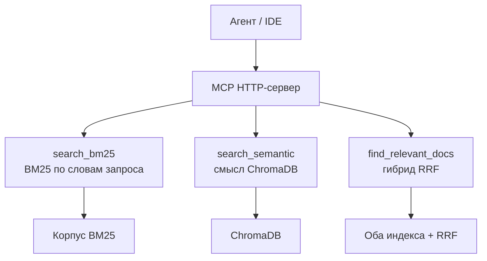

# Спецификация MCP-сервера

HTTP-сервер Model Context Protocol для уже построенного корпуса Star Trek. Сервер не индексирует файлы и не генерирует ответ. Он отдаёт чанки тремя поисками: Okapi BM25 по словам запроса, смысловой поиск по коллекции ChromaDB и гибридный поиск (оба канала, слияние RRF).

Эта спецификация — источник решений для плана и кода. Числа, имена и границы ниже обязательны.

## Три инструмента



## Как исполнять

Код по этому файлу пишется только после плана.

1. Сначала скил [`.cursor/skills/writing-plans.SKILL.md`](../.cursor/skills/writing-plans.SKILL.md). Он превращает эту спецификацию в план реализации: файлы, сигнатуры, тесты, шаги. План ссылается на этот документ и не заменяет его. Каталог документов проекта — `Docs` (с заглавной буквы). Путь `docs/` из скила для этого репозитория не используется.
2. При проектировании и написании сервера — скил [`.cursor/skills/dotnet-mcp-builder.SKILL.md`](../.cursor/skills/dotnet-mcp-builder.SKILL.md). Для этой работы скил требует справочники `references/packages.md`, `references/transport-http.md`, `references/tool-primitive.md` и `references/testing.md`. Версии пакетов, имена методов SDK, схема Streamable HTTP и способ задать имя инструмента берутся оттуда. Если справочника нет рядом со скилом в репозитории, действуют кардинальные правила в файле скила, а незнакомый метод сверяется с [API reference](https://csharp.sdk.modelcontextprotocol.io/api/ModelContextProtocol.html), на который скил ссылается. Метод не выдумывается.
3. Для актуальной документации библиотек используется MCP **Context7** (сервер `plugin-context7-context7`). Память модели и общий поиск в интернете документацию пакетов не заменяют. Сначала `resolve-library-id` (имя библиотеки и запрос), затем `query-docs` с полученным идентификатором `/org/project` и языком `C#`. Идентификатор вида `/org/project` или `/org/project/version`, если он уже известен, можно передать в `query-docs` сразу. Запрос — одна тема за вызов. Так сверяются пакеты `ModelContextProtocol` и `ModelContextProtocol.AspNetCore`, Streamable HTTP, атрибуты инструментов и хостинг на ASP.NET Core / .NET 10 до того, как план зафиксирует сигнатуру, и ещё раз перед кодом, если план писался не в тот же день.
4. Расхождение источников: у скила dotnet-mcp-builder и у Context7 — способ вызвать SDK и то, как он выглядит в текущей версии. У этой спецификации — транспорт HTTP, .NET 10, три инструмента, пути, лимиты, Docker и то, что сервер не индексирует корпус. Context7 не меняет эти границы.

План по скилу writing-plans останавливается на ревью человеком. Код начинается после подтверждения плана.

## Зачем этот шаг

Индексатор `src/StarTrek.Indexer` уже режет `SourceFiles`, считает векторы `intfloat/multilingual-e5-small` и хранит их в коллекции ChromaDB `startrek`, а корпус BM25 — в `Data/bm25/corpus.json`. Команды `analyze`, `chunk`, `embed` и `health-check` остаются у индексатора. Командной строки поиска нет, и эта спецификация её не добавляет. `HybridSearchService` сливает список BM25 и список Chroma через RRF; этот сервер отдаёт слияние инструментом `find_relevant_docs`.

Исходное задание — [0. ТЗ. project_Corrective_RAG_MCP-248024-92e22a.md](0.%20ТЗ.%20project_Corrective_RAG_MCP-248024-92e22a.md). Решения, которые уже заменили части ТЗ, — [6. Plan.md](6.%20Plan.md) и [7. План запуска в Docker.md](7.%20План%20запуска%20в%20Docker.md). Этот шаг даёт агенту IDE три поисковых инструмента и только чанки.

Генерация ответа, переписывание запроса и оценка чанков (Corrective RAG) в этот документ не входят — не потому что «когда-нибудь потом», а потому что это отдельный продуктовый шаг после MCP-сервера. Исходное ТЗ строило этот контур на LangGraph и LangChain. Следующий шаг сделает ту же оркестрацию на Microsoft Semantic Kernel: возьмёт чанки, которые вернули инструменты этого сервера, перепишет запрос, оценит фрагменты и сочинит ответ. В коде и тестах этой спецификации генерации, переписывания запроса и оценки чанков нет: агент IDE получает чанки и сам решает, что с ними делать.

| Часть задания | Где она живёт |
|---|---|
| Нарезка, эмбеддинги, запись в ChromaDB, пересборка BM25 | Уже в `StarTrek.Indexer`. MCP их не вызывает. |
| Поиск по словам запроса (Okapi BM25) | Инструмент `search_bm25`. |
| Поиск по смыслу (ChromaDB) | Инструмент `search_semantic`. |
| Слияние RRF (BM25 + вектор) | Инструмент `find_relevant_docs` вызывает существующий `HybridSearchService`. |
| Ответ на вопрос, переписывание запроса, оценка чанков (Corrective RAG) | Следующий продуктовый шаг: Microsoft Semantic Kernel вместо LangGraph/LangChain из ТЗ. Вне этой спецификации. |
| Язык реализации | C# / .NET 10. |

## Глобальные ограничения

- Рантайм — `net10.0`. Версия SDK — `10.0.401` с `rollForward: latestPatch`, как в `global.json`.
- Пакеты MCP — стабильная линия **2.x**: `ModelContextProtocol` и `ModelContextProtocol.AspNetCore`. Превью `0.x` и линия `1.x` не используются. Номер версии и имена методов перед планом и кодом подтверждает MCP Context7, как в разделе «Как исполнять».
- Транспорт — Streamable HTTP. STDIO не включается. Устаревший SSE (`EnableLegacySse`) не включается. В 2.x HTTP по умолчанию stateless; `Stateless = false` не задаётся.
- Возможности, которые спецификация MCP 2026-07-28 помечает устаревшими, не проектируются: roots, sampling, логирование по каналу MCP. Журнал процесса — `ILogger` и файлы GELF, раздел «Журнал».
- Промптов, ресурсов, completions, elicitation, MCP Apps и Tasks нет. Только три инструмента: `search_bm25`, `search_semantic`, `find_relevant_docs`.
- Python, FastMCP, LangChain, LangGraph и Ollama в решение не добавляются. Платный API эмбеддингов не вызывается.
- Идентификаторы в коде — на английском. Описания инструментов, тексты ошибок инструментов, сообщения журнала для человека и документы в `Docs/` — на русском.
- Новая папка — CamelCase с заглавной буквы.
- Пороги, адреса и пути журнала — в `appsettings.json` и в переменных `STARTREK_`. В коде те же числа и пути не дублируются вторым источником.
- Журнал: уровень `Debug`; библиотека GELF / Graylog для .NET пишет в файлы; инициализация и каждый MCP-запрос — разные файлы; в запросе — входящая и исходящая модели (request model и response model). Живой сервер Graylog не обязателен. Секретов у сервера нет, в журнал они не пишутся.
- MCP не пишет в индекс и корпус: не пишет в ChromaDB, в `Data/bm25`, в `Data/staging`, в `ChromaDB/` и в `SourceFiles/`. Единственная запись процесса сервера на диск — файлы журнала по путям `Mcp:Logging`. Папку `ChromaDB` процесс не открывает: чтение коллекции идёт по HTTP API. Индексацию сервер не запускает. Интеграционные тесты этой спецификации пишут артефакты прогонов в `Tests/StarTrek.Mcp.Tests/Artifacts`; это выход тестов, не запись сервера в индекс.
- `model.onnx` в git и в образ Docker не кладётся.
- Текст чанка в ответе — как в коллекции: без префикса `passage: ` и без символов `#`.
- Префикс запроса эмбеддинга — `query: `. Его добавляет существующий `IQueryEmbeddingGenerator.GenerateQueryAsync`. Инструмент сам префикс не приписывает.
- BM25: `K1 = 1.5`, `B = 0.75`. Коллекция ChromaDB — `startrek`. Размер вектора — 384.

## Проект

Отдельное исполняемое приложение, не библиотека и не сайт.

| Что | Путь |
|---|---|
| Проект сервера | `src/StarTrek.Mcp/StarTrek.Mcp.csproj` |
| Пространство имён | `StarTrek.Mcp` |
| Тесты | `Tests/StarTrek.Mcp.Tests` |
| Решение | оба проекта добавляются в `MCP.RAG.StarTrek.sln` |

Проект ссылается на `src/StarTrek.Indexer/StarTrek.Indexer.csproj` и вызывает уже существующие клиент ChromaDB, корпус BM25, генератор эмбеддингов и `HybridSearchService`. Второй реализации HTTP-клиента Chroma, токенизатора BM25, ONNX и RRF в `StarTrek.Mcp` нет.

SDK проекта — тот, который `references/transport-http.md` задаёт для Streamable HTTP на Kestrel (ожидается `Microsoft.NET.Sdk.Web`). Страниц, Razor и контроллеров нет. Процесс — бэкенд: стартовал, слушает HTTP, отдаёт MCP. Команд индексатора у него нет.

`AddStarTrekIndexer` целиком не подключается: эта регистрация поднимает команды `analyze`, `chunk` и `embed` и при первом обращении к генератору требует `model.onnx`. Сервер регистрирует только чтение настроек `Indexer`, `ChromaHttpClient`, `Bm25IndexHolder`, `HybridSearchService` и ленивый `IQueryEmbeddingGenerator`. Генератор создаётся внутри вызова смыслового или гибридного поиска, а не при старте хоста.

Слушатель HTTP поднимается и без `model.onnx`, без `tokenizer.json`, без `Data/bm25/corpus.json` и без ответа ChromaDB. Отсутствие индекса сообщает инструмент, который им пользуется.

## Три поиска

Три инструмента. `search_bm25` ходит в корпус BM25, `search_semantic` — в коллекцию ChromaDB, `find_relevant_docs` вызывает `HybridSearchService` (оба индекса и RRF).

Общие параметры трёх инструментов:

| Параметр | Тип | Правило |
|---|---|---|
| `query` | строка, обязательный | Пустая строка и строка из одних пробелов — ошибка инструмента. Поиск не вызывается. |
| `limit` | целое, необязательный | У `search_bm25` и `search_semantic`. Нет значения — `Indexer:Search:ResultCount` (сейчас 10). Значение меньше 1 приводится к 1. Значение больше 20 приводится к 20. 20 — потолок `VectorTopN` и `Bm25TopN`. Вне диапазона 1…20 это не ошибка инструмента: поиск вызывается с уже приведённым `limit`. |
| `top_k` | целое, необязательный | У `find_relevant_docs`. То же правило, что у `limit`: нет значения — 10, меньше 1 приводится к 1, больше 20 — к 20. |

Успешный ответ с нулём чанков — нормальный результат: запрос разобран, совпадений нет. Это не ошибка.

Ошибка инструмента — текст на русском, в котором названо, чего не хватает (`model.onnx`, корпус BM25, коллекция `startrek`, адрес ChromaDB). Исключение наружу процесса не валит слушатель. Запись в хранилища при ошибке не начинается, потому что инструменты ничего не пишут и в успехе.

### `search_bm25` — слова запроса (Okapi BM25)

Имя инструмента в протоколе: `search_bm25`.

Описание инструмента (этот текст и есть то, что видит агент IDE):

> Ищет чанки корпуса Star Trek по словам запроса в индексе Okapi BM25 (k1 = 1.5, b = 0.75). Запрос — русская фраза любой длины: одно слово или несколько. Строка режется тем же Bm25Tokenizer, которым собран корпус; это не string.Contains и не поиск только кода корабля. Вызывай, когда важны сами слова вопроса: обычные русские слова, имена, термины, номера вроде NCC-1701-D. Не вызывай, когда нужны смысл и перефраз без совпадения слов: для смысла есть search_semantic, для обоих каналов — find_relevant_docs. Индекс не перестраивает и файлы не индексирует.

Описание `query`: «Фраза любой длины: одно или несколько слов на русском или идентификатор. Регистр не важен. Токенизатор режет её на слова; отдельного поиска подстроки нет.»

Описание `limit`: «Сколько чанков вернуть. Нет значения — 10. Меньше 1 приводится к 1, больше 20 — к 20.»

Поведение:

1. Корпус читается через `Bm25IndexHolder.GetOrLoad` для коллекции из настроек. Файл — `Indexer:Paths:Bm25Corpus` (`Data/bm25/corpus.json`). В корпусе лежат id чанка и токены, не исходный текст.
2. Строка запроса режется тем же `Bm25Tokenizer`, которым собран корпус. Отдельного поиска `string.Contains` нет.
3. Токен — слово из букв и цифр в нижнем регистре. Код с цифрой и дефисами остаётся одним токеном (`NCC-1701-D`, `NX-01`). Слово с дефисом и без цифры режется (`Таль-Шанар` → `таль` и `шанар`). Запрос из нескольких русских слов даёт несколько токенов; BM25 ранжирует чанки по этим токенам, а не по одному точному идентификатору.
4. Если после токенизации не осталось ни одного токена, инструмент возвращает ошибку, что в запросе нет искомых слов. Пустой список чанков в этом случае не считается успехом.
5. `Bm25Index.Search` возвращает не больше `limit` чанков, у которых есть хотя бы один токен запроса. Порядок — по убыванию оценки BM25, при равной оценке — по id.
6. Текст и метаданные этих id дочитываются из ChromaDB методом `GetByIdsAsync`. Id, которого в коллекции уже нет, в ответ не попадает.
7. ONNX-модель не загружается. Префикс `query: ` не используется. `HybridSearchService` не вызывается.

Оценка в ответе называется `bm25Score`: больше — ближе к запросу.

Нет файла корпуса, корпус устарел или собран для другой коллекции — ошибка с тем же смыслом, что у `Bm25IndexHolder`: сначала нужна команда `embed` индексатора. Сервер файл корпуса не создаёт.

ChromaDB недоступна или коллекции `startrek` нет — ошибка. Оценки BM25 без текста чанка не отдаются: агенту нужен текст.

### `search_semantic` — смысл в ChromaDB

Имя инструмента в протоколе: `search_semantic`.

Описание инструмента:

> Ищет чанки корпуса Star Trek по смыслу запроса в коллекции ChromaDB startrek. Вектор считает локальная модель intfloat/multilingual-e5-small, 384 измерения. Вызывай, когда вопрос задан своими словами и нужный фрагмент может быть другими словами. Не вызывай, когда важны сами слова запроса без перефраза: для слов есть search_bm25. Если нужны и слова, и смысл — find_relevant_docs. Ответ не сочиняет, только возвращает чанки и расстояние.

Описание `query`: «Вопрос или фраза своими словами. В хранилище уходит вектор, а не поиск подстроки.»

Описание `limit`: «Сколько ближайших чанков вернуть. Нет значения — 10. Меньше 1 приводится к 1, больше 20 — к 20.»

Поведение:

1. `IQueryEmbeddingGenerator.GenerateQueryAsync` считает вектор. Префикс запроса `query: ` добавляет генератор. Префикс документа `passage: ` в этот вызов не подставляется.
2. `ChromaHttpClient.QueryAsync` по коллекции `startrek` запрашивает ровно `limit` соседей, с полями `documents`, `metadatas`, `distances`.
3. Порядок ответа — порядок ChromaDB: по возрастанию расстояния. Для косинусной коллекции расстояние — `1 − сходство`. Меньше — ближе. Повторной сортировки и смешивания с BM25 нет.
4. Корпус BM25 не читается. `HybridSearchService` не вызывается.

Оценка в ответе называется `distance`.

Нет `model.onnx` или `tokenizer.json` — ошибка с путём файла и ссылкой на скачивание, которую уже формулирует индексатор (`OnnxE5EmbeddingGenerator`). Процесс сервера файл из интернета не качает. В Compose до старта `mcp` его скачивает сервис `model-pull`.

ChromaDB недоступна или коллекции нет — ошибка. Коллекция не создаётся.

### `find_relevant_docs` — слова и смысл (RRF)

Имя инструмента в протоколе: `find_relevant_docs`.

Описание инструмента:

> Ищет чанки корпуса Star Trek сразу по словам и по смыслу: Okapi BM25 по токенам запроса и векторный поиск в коллекции ChromaDB startrek, затем сливает оба списка через Reciprocal Rank Fusion (RRF). Запрос — фраза любой длины. Вызывай, когда в вопросе нужны и точные слова (имена, термины, номера), и смысл или перефраз. Не вызывай, если достаточно одного канала: только слова — search_bm25, только смысл — search_semantic. Ответ не сочиняет, только возвращает чанки и оценку RRF.

Описание `query`: «Вопрос или фраза любой длины. Идут и в токенизатор BM25, и в векторный запрос.»

Описание `top_k`: «Сколько чанков вернуть после слияния RRF. Нет значения — 10. Меньше 1 приводится к 1, больше 20 — к 20.»

Поведение:

1. Инструмент приводит `top_k` по общему правилу и вызывает существующий `HybridSearchService.SearchAsync`. Слияние RRF в слое MCP не пишется заново.
2. Сервис считает вектор через `IQueryEmbeddingGenerator.GenerateQueryAsync` (префикс `query: ` добавляет генератор), запрашивает `Indexer:Search:VectorTopN` соседей из ChromaDB и `Indexer:Search:Bm25TopN` попаданий BM25, сливает списки через RRF с `Indexer:Search:RrfK` (сейчас 60) и отдаёт не больше `top_k` чанков.
3. Порядок ответа — порядок слияния RRF: больше `rrfScore` — выше. Повторной сортировки в MCP нет.
4. Если после токенизации BM25 не осталось токенов, канал BM25 даёт пустой список, векторный канал всё равно выполняется. Это не ошибка инструмента (ошибка «нет искомых слов» — только у `search_bm25`).
5. Нет корпуса BM25, нет `model.onnx` / `tokenizer.json`, ChromaDB недоступна или коллекции `startrek` нет — ошибка инструмента. Пустой список чанков из‑за отсутствия индекса не считается успехом.

Оценка в ответе называется `rrfScore`: больше — выше после слияния. Поля вклада каналов — как у `HybridSearchHit`.

### Поля одного чанка в ответе

Все три инструмента возвращают запрос и список чанков. Поля метаданных читаются из плоских metadata ChromaDB. Нет ключа — поле отсутствует, а не пустая выдуманная строка.

| Поле | Смысл |
|---|---|
| `id` | Id чанка, формат `document_id:chunk_index` |
| `text` | Текст чанка из коллекции |
| `bm25Score` | У `search_bm25`; у `find_relevant_docs`, если чанк был в списке BM25 |
| `distance` | У `search_semantic`; у `find_relevant_docs`, если чанк был в списке Chroma |
| `rrfScore` | Только у `find_relevant_docs`: оценка Reciprocal Rank Fusion |
| `vectorRank` | Только у `find_relevant_docs`, если чанк был в списке Chroma |
| `bm25Rank` | Только у `find_relevant_docs`, если чанк был в списке BM25 |
| `sourceFile` | `source_file` |
| `title` | `title` |
| `originalTitle` | `original_title` |
| `entityType` | `entity_type` |
| `sectionPath` | `section_path` |
| `position` | `position`, строка вида `lines 12-40` |
| `chunkIndex` | `chunk_index` |

Типы C# для этих ответов живут в `StarTrek.Indexer.Search`, рядом с существующим гибридным поиском (`HybridSearchHit`, `HybridSearchResult`). Инструменты в `StarTrek.Mcp` только проверяют вход, приводят `limit` или `top_k`, вызывают эти типы и отдают результат. Имена методов поиска и записей план фиксирует по этой таблице и по скилу writing-plans; второй набор имён в MCP-слое не появляется.

Класс инструментов помечается так, как требует `references/tool-primitive.md` (`[McpServerToolType]`, `[McpServerTool]`, `[Description]` на инструменте и на каждом параметре). Регистрация — явная строка вроде `WithToolsFromAssembly` или `WithTools<T>` из того же справочника. Класс без регистрации не считается реализованным.

## Конфигурация

Секция `Indexer` берётся из `src/StarTrek.Indexer/appsettings.json`. Второй копии порогов BM25, адреса Chroma и путей в проекте MCP нет.

Свои настройки сервера — `src/StarTrek.Mcp/appsettings.json`:

```json
{
  "Mcp": {
    "Path": "/mcp",
    "Urls": "http://0.0.0.0:8080",
    "Logging": {
      "Level": "Debug",
      "InitializationLogPath": "Data/Logs/mcp-init.log",
      "RequestLogPath": "Data/Logs/mcp-requests.log"
    }
  }
}
```

Переменные окружения с префиксом `STARTREK_` перекрывают оба файла. Для вложенных ключей разделитель `__`, как у индексатора: `STARTREK_Indexer__Chroma__Endpoint`, `STARTREK_Mcp__Path`, `STARTREK_Mcp__Urls`, `STARTREK_Mcp__Logging__Level`, `STARTREK_Mcp__Logging__InitializationLogPath`, `STARTREK_Mcp__Logging__RequestLogPath`.

Локальный адрес ChromaDB остаётся `http://127.0.0.1:8000`. В Compose его перекрывает `http://chromadb:8000`.

Корень репозитория ищется так же, как у индексатора: вверх от текущей папки и от `AppContext.BaseDirectory`, пока не найдётся `MCP.RAG.StarTrek.sln`. Относительные пути `Indexer:Paths` и `Mcp:Logging` считаются от этого корня. Абсолютный путь в настройке или в переменной окружения используется как есть.

## Журнал

Процесс пишет журнал через `ILogger`. Канал логирования протокола MCP не включается.

Приёмник — библиотека GELF / Graylog для .NET с файловым sink. Записи уходят в файлы, а не в обязательный сетевой Graylog. Живой сервер Graylog для `dotnet run`, для Docker и для интеграционных тестов не нужен и не является блокером старта: слушатель HTTP поднимается без него. Имя пакета и способ задать file sink на уровне `Debug` перед планом и кодом подтверждает MCP Context7, как в разделе «Как исполнять».

Уровень — `Debug`. Значение берётся из `Mcp:Logging:Level`, не из литерала в коде.

Два отдельных файла. Инициализация и трафик запросов не смешиваются.

| Файл | Настройка | Что попадает |
|---|---|---|
| Инициализация | `Mcp:Logging:InitializationLogPath` | Старт хоста, слушатель HTTP, конечная точка MCP, регистрация инструментов `search_bm25`, `search_semantic` и `find_relevant_docs`. По умолчанию `Data/Logs/mcp-init.log`. |
| Запросы | `Mcp:Logging:RequestLogPath` | Каждый MCP-запрос. По умолчанию `Data/Logs/mcp-requests.log`. |

В файл запросов пишутся входящая и исходящая модели: request model (то, что пришло: имя инструмента, параметр `query` и число результатов — `limit` у `search_bm25` и `search_semantic`, `top_k` у `find_relevant_docs`) и response model (то, что ушло: список чанков с полями ответа или текст ошибки инструмента). Это полезные нагрузки вызова, а не только факт, что запрос был.

`GET /health` в файл запросов MCP не пишется: это проверка процесса, не вызов инструмента.

Секретов у сервера нет: авторизации нет, платный API не вызывается. Поля, которых нет, в журнал не выдумываются. Если позже в настройках появится секрет, в файлы он не попадает.

Каталог `Data/Logs` — новая папка CamelCase под уже существующим `Data/`. Это не корпус и не индекс. Сервер по-прежнему не пишет в `Data/bm25`, `Data/staging`, `ChromaDB/` и `SourceFiles/` и команды индексатора не вызывает.

Тексты журнала для человека — на русском. Имена категорий `ILogger`, ключей настроек и имён файлов — на английском.

## HTTP

- Метод протокола — тот, который задаёт `references/transport-http.md` для Streamable HTTP. Путь конечной точки — значение `Mcp:Path`, по умолчанию `/mcp`. Корень приложения конечной точкой MCP не становится.
- Слушает адрес `Mcp:Urls`, по умолчанию `http://0.0.0.0:8080`.
- `GET /health` возвращает код 200 и тело `MCP-сервер отвечает: healthy.` Этот запрос не открывает корпус BM25, не грузит ONNX и не вызывает ChromaDB. Строка означает, что процесс слушает, а не что индекс на месте.
- Авторизации нет: сервер для локального Docker и машины разработчика.
- Журнал — раздел «Журнал»: `ILogger` и два файла GELF. Консоль процесса может дублировать записи для `docker compose logs`, но инициализация и запросы MCP в файлах не смешиваются. Инструмент не печатает чанки в stdout: чанки уходят телом ответа MCP и копией модели ответа в файл запросов.

Проверка с машины разработчика, когда Compose уже поднял сервис: HTTP-клиент MCP на `http://127.0.0.1:8080/mcp`.

## Docker

Сервис индексатора и сервис ChromaDB не меняют свои контракты. Образ `startrek-indexer`, контейнер `startrek-indexer`, команда по умолчанию `health-check`. Том Chroma остаётся `./ChromaDB:/data`.

Новый сервис Compose:

| Поле | Значение |
|---|---|
| Сервис | `mcp` |
| Образ | `startrek-mcp` |
| Контейнер | `startrek-mcp` |
| Dockerfile | `Dockerfile.mcp` в корне репозитория |
| Порт | `8080:8080` |
| Зависимость | `depends_on: chromadb` — только порядок запуска |
| Перезапуск | `restart: unless-stopped` |

Переменные сервиса:

```text
STARTREK_Indexer__Chroma__Endpoint=http://chromadb:8000
STARTREK_Indexer__Paths__Bm25Corpus=/opt/startrek/data/bm25/corpus.json
STARTREK_Indexer__Paths__EmbeddingModel=/opt/startrek/models/multilingual-e5-small
STARTREK_Mcp__Urls=http://0.0.0.0:8080
STARTREK_Mcp__Logging__Level=Debug
STARTREK_Mcp__Logging__InitializationLogPath=/opt/startrek/data/logs/mcp-init.log
STARTREK_Mcp__Logging__RequestLogPath=/opt/startrek/data/logs/mcp-requests.log
```

Тома только на чтение:

```text
./Data/bm25:/opt/startrek/data/bm25:ro
./Models/multilingual-e5-small:/opt/startrek/models/multilingual-e5-small:ro
```

Том журнала — на запись. Это не корпус и не индекс Chroma:

```text
./Data/Logs:/opt/startrek/data/logs
```

Каталог `/data` у этого сервиса не используется: его ждёт образ ChromaDB.

Образ:

- сборка `mcr.microsoft.com/dotnet/sdk:10.0`;
- запуск — образ ASP.NET, который соответствует HTTP-хосту скила, на базе glibc, не Alpine: в процесс попадает `Microsoft.ML.OnnxRuntime`. Ожидаемый тег — `mcr.microsoft.com/dotnet/aspnet:10.0`;
- `global.json`, файл решения и каталог `src/StarTrek.Mcp` вместе с зависимостью `src/StarTrek.Indexer`;
- публикация Release проекта `StarTrek.Mcp`;
- тестовые проекты в образ не входят;
- `model.onnx`, `Data/`, `ChromaDB/` и `SourceFiles/` в контекст сборки не копируются (они уже исключены `.dockerignore`);
- `LANG=C.UTF-8`;
- файл решения лежит так, чтобы поиск корня по `MCP.RAG.StarTrek.sln` его находил. Рабочая схема индексатора — `/opt/startrek/MCP.RAG.StarTrek.sln` и приложение в `/opt/startrek/app`;
- процесс держит HTTP и не завершается после старта. `CMD` индексатора `health-check` этому образу не копируется.

`docker compose up` по-прежнему не запускает `analyze`, `chunk` и `embed`. Он поднимает ChromaDB, кратко выполняет `health-check` индексатора и оставляет `startrek-mcp` слушать порт 8080. Перед стартом `mcp` сервис `model-pull` скачивает `model.onnx` в `./Models/multilingual-e5-small`, если файла ещё нет. В образ файл по-прежнему не копируется.

Проверка образа без индексации и без требования, чтобы модель лежала в образе:

```powershell
docker compose build mcp
docker compose up -d chromadb mcp
```

Ожидание: `GET http://127.0.0.1:8080/health` даёт код 200 и тело `MCP-сервер отвечает: healthy.` Запрос `/health` не читает корпус BM25 и не открывает `model.onnx`. Команда `up` для `mcp` также запускает `model-pull`: если файла на хосте не было, он появляется до старта слушателя. Поисковый инструмент при отсутствии индекса возвращает ошибку и не пишет в индекс. Живой Graylog для этой проверки не нужен.

Существующую коллекцию и `./ChromaDB` проверка не очищает. `docker compose down -v` для этой проверки не используется.

## Пример подключения агента

Каталог `.vscode/` в git не входит. Пример конфигурации коммитится в корне как `mcp.example.json`, чтобы его можно было скопировать в `.vscode/mcp.json` для VS Code Copilot. Содержимое — HTTP-адрес, не команда STDIO:

```json
{
  "servers": {
    "startrek": {
      "url": "http://127.0.0.1:8080/mcp"
    }
  }
}
```

Если актуальная схема файла у клиента IDE отличается, правится обёртка примера. Адрес `http://127.0.0.1:8080/mcp` остаётся.

Раздел README «2. Запуск MCP-сервера» заменяет заглушку «в разработке» на запуск сервиса `mcp`, адрес, три инструмента и путь к примеру конфигурации. Команды индексатора в README не переписываются.

## Тесты

`dotnet test` включает `Tests/StarTrek.Mcp.Tests` и остаётся зелёным без Docker и без `model.onnx`: модульные тесты не требуют живых сервисов, интеграционные прогоны из подраздела ниже пропускаются, если ChromaDB или MCP не отвечают.

Живая ChromaDB в модульных тестах не обязательна. Сеть Chroma подменяется так же, как в тестах индексатора (`FakeChromaServer` или локальный двойник того же контракта). ONNX в модульных тестах инструментов не загружается: генератор запроса подменяется двойником, который возвращает вектор известной длины 384.

Модульные тесты фиксируют такое поведение:

- `search_bm25` ранжирует чанк, в котором есть токены запроса (и одно слово, и русская фраза из нескольких слов), и не вызывает генератор эмбеддингов;
- код с дефисом и цифрой ищется одним токеном (`NCC-1701-D`); это частный случай токенизатора, а не единственный вид запроса BM25;
- `search_semantic` вызывает генератор запроса и векторный запрос ChromaDB и не читает корпус BM25;
- `find_relevant_docs` вызывает `HybridSearchService` (вектор + BM25 + RRF) и не пишет слияние заново;
- в текст эмбеддинга инструмент не добавляет второй префикс `query: ` поверх генератора;
- пустой `query` и запрос без токенов для `search_bm25` дают ошибку и пустое хранилище не создают;
- `limit` и `top_k` меньше 1 приводятся к 1, больше 20 — к 20: поиск вызывается, ошибки инструмента из‑за диапазона нет;
- отсутствует корпус BM25, коллекция или ответ ChromaDB — ошибка инструмента, без записи;
- описания трёх инструментов и их параметров непустые и содержат имена `search_bm25`, `search_semantic` и `find_relevant_docs` так, чтобы агент различал слова запроса, смысл и оба канала сразу;
- `GET /health` не обращается к ChromaDB, ONNX и корпусу BM25.

Существующие тесты `StarTrek.Indexer.Tests` остаются зелёными. Команды индексатора не получают новых веток.

### Интеграционные прогоны с живым MCP

Эта спецификация владеет интеграционными тестами трёх инструментов. Они живут в `Tests/StarTrek.Mcp.Tests`. Нужны живой MCP, живая ChromaDB и уже построенные индексы (`docker compose up -d` сервисов `chromadb` и `mcp`, корпус `Data/bm25/corpus.json` и коллекция `startrek`). Живой Graylog не нужен.

Пропуск — как у существующего `ChromaServerFact`: если `http://127.0.0.1:8000` (ChromaDB) или `http://127.0.0.1:8080/health` (MCP) не отвечает, тесты этого подраздела получают `Skip` и не падают. Человек в MCP Inspector не кликает: вызов и артефакты делает xUnit.

Источник вопросов — [5. Примеры вопросов.md](5.%20Примеры%20вопросов.md). Нумерация там однозначная.

| Инструмент | Сколько прогонов | Какие вопросы |
|---|---|---|
| `search_semantic` | 10 | Первые десять пронумерованных вопросов файла: **1–10**. |
| `search_bm25` | 10 | Вопросы, где в тексте корпуса должны встретиться сами слова и имена: **8, 11, 12, 14, 16, 18, 20, 22, 25, 26**. |
| `find_relevant_docs` | 10 | Те же первые десять, что у смыслового поиска: **1–10**. Гибрид нужен, потому что в этой десятке есть и перефраз, и имена. |

Итого 30 прогонов. Текст `query` — формулировка вопроса из файла, без подсказки-ответа и без пути `SourceFiles`. `limit` и `top_k` в этих прогонах не передаются: действует значение по умолчанию.

Каждый прогон пишет артефакты. Каталог:

`Tests/StarTrek.Mcp.Tests/Artifacts/{yyyyMMdd-HHmmss}/`

Метка времени — момент старта набора на машине теста, формат `yyyyMMdd-HHmmss`. Внутри — по одной подпапке на прогон, имя сразу говорит канал и номер:

| Подпапка | Прогон |
|---|---|
| `Semantic-01` … `Semantic-10` | Вопросы 1–10, `search_semantic` |
| `Bm25-01` … `Bm25-10` | Вопросы 8, 11, 12, 14, 16, 18, 20, 22, 25, 26 в этом порядке, `search_bm25` |
| `Hybrid-01` … `Hybrid-10` | Вопросы 1–10, `find_relevant_docs` |

В каждой подпапке тест сам пишет четыре файла:

| Файл | Содержимое |
|---|---|
| `query.txt` | Текст запроса |
| `response.txt` | Тело ответа MCP (чанки или текст ошибки) |
| `duration.txt` | Длительность вызова в миллисекундах, одно число и единица, например `1842 ms` |
| `screenshot.png` | Снимок полезной нагрузки этого прогона |

Скриншот обязателен на каждый прогон. Его пишет тест, не человек. Практичное правило для xUnit: тест сохраняет PNG с текстом запроса, ответом и длительностью (растровая копия полезной нагрузки через ImageSharp, `System.Drawing` или аналог). Дополнительно можно писать `snapshot.html` с тем же содержимым. Живой браузер и клики в MCP Inspector не требуются: если снять окно Inspector из xUnit непрактично, PNG ответа всё равно пишется. Прогон без `screenshot.png` (и без HTML-снимка, если PNG собрать не удалось) считается незавершённым.

Артефакты — выход тестов. Сервер MCP в `Tests/StarTrek.Mcp.Tests/Artifacts` не пишет. Индекс и корпус эти прогоны не очищают и не пересобирают.

## Вне этого шага

Сюда не входят инструменты `index_folder`, `ask_question` и `index_status`, граф с повтором запроса, генеративная модель и правка текста в `SourceFiles`. Генерация ответа, переписывание запроса и оценка чанков — следующий продуктовый шаг на Microsoft Semantic Kernel, не этот документ. Индексация по-прежнему выполняется явно: `embed` индексатора, когда об этом попросили отдельно.
