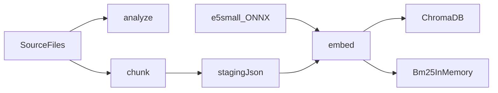

# MCP.RAG.StarTrek

Консольный индексатор корпуса `SourceFiles` (Star Trek, русский язык) на C# / .NET 10: нарезка по решёткам, локальные эмбеддинги `intfloat/multilingual-e5-small` через ONNX Runtime, коллекция в ChromaDB и индекс BM25. Python в решении нет. Подробности и обоснования — в [Docs/6. Plan.md](Docs/6.%20Plan.md). Запуск индексатора в Docker — в [Docs/7. План запуска в Docker.md](Docs/7.%20План%20запуска%20в%20Docker.md).

## Что нужно заранее

- **С Docker** — [Docker](https://www.docker.com/) (ChromaDB и образ `startrek-indexer`); SDK на хосте не нужен;
- **Без Docker** — SDK .NET 10 (версия в [global.json](global.json));
- ONNX-модель `model.onnx` (~448 МБ): [скачать](https://huggingface.co/intfloat/multilingual-e5-small/resolve/main/onnx/model.onnx) в `Models/multilingual-e5-small/` (нужна для `embed`).

## Запуск

### 1. Запуск индексатора

`health-check` и `help` не требуют ChromaDB; `embed` — требует (контейнер `startrek-chromadb`). `docker compose up` корпус не индексирует: у сервиса `indexer` по умолчанию `health-check`.

#### С Docker

SDK на хосте не нужен. Сборка образа `startrek-indexer`, `health-check` и запуск команд в контейнере — в [Docs/7. План запуска в Docker.md](Docs/7.%20План%20запуска%20в%20Docker.md).

#### Без Docker

Нужен SDK .NET 10.

```powershell
dotnet run --project src/StarTrek.Indexer -- <команда>
```

| Команда | Что делает |
|---|---|
| `analyze` | Только печатает отчёт: файлы, уровни заголовков, пустые блоки, разделы длиннее 480 и короче 80 токенов (`--all` — показать все, а не первые 20). Ничего не пишет. |
| `chunk` | Режет файлы по решёткам и пишет JSON в `Data/staging/` без векторов. Файлы с тем же `content_hash` пропускает (`--force` — переделать все). В ChromaDB ничего не кладёт. |
| `embed` | Читает `Data/staging/`, считает векторы e5 ONNX, пишет (upsert) чанки в коллекцию `startrek` и пересобирает индекс BM25 (корпус сохраняется в `Data/bm25/corpus.json`). Без модели или без ответа ChromaDB останавливается, уже записанное не трогает. `--force` — пересчитать всё. |
| `health-check` | Печатает `Индексатор отвечает: healthy.` и возвращает код 0. Не читает корпус, не грузит ONNX и не вызывает ChromaDB. |
| `help` | Печатает список команд и завершается с кодом 0. |

### 2. Запуск MCP-сервера

Сервис `mcp` — образ и контейнер `startrek-mcp`, порт `8080`. Сборка и запуск:

```powershell
docker compose build mcp
docker compose up -d chromadb mcp
```

`docker compose up` по-прежнему не вызывает `analyze`, `chunk` и `embed`. Сервис `indexer` выполняет `health-check` и завершается. Сервис `mcp` остаётся слушать HTTP.

Адрес клиента: `http://127.0.0.1:8080/mcp`.

Проверка процесса: `GET http://127.0.0.1:8080/health`. Ответ — код 200 и тело `MCP-сервер отвечает: healthy.` Этот запрос не читает корпус BM25, не грузит ONNX и не вызывает ChromaDB: строка значит, что процесс слушает, а не что индекс на месте. Проверка успешна и без корпуса, и без `model.onnx`.

Три инструмента:

- `search_bm25` — слова запроса (Okapi BM25);
- `search_semantic` — смысл в ChromaDB;
- `search_hybrid` — слова и смысл (RRF).

Пример подключения — файл `mcp.example.json` в корне репозитория. Скопируйте его в `.vscode/mcp.json` для VS Code Copilot. Каталог `.vscode/` в git не входит. В примере адрес HTTP, не команда STDIO. 

## Модель эмбеддингов

`tokenizer.json` лежит в `Models/multilingual-e5-small/` и хранится в git. Это копия модели [intfloat/multilingual-e5-small](https://huggingface.co/intfloat/multilingual-e5-small). Откуда скачаны файлы и на каких правах они используются — в [Models/LICENSE.md](Models/LICENSE.md).

`Models/multilingual-e5-small/model.onnx` в git не входит: файл весит около 448 МБ. Скачайте его и сохраните по пути `Models/multilingual-e5-small/model.onnx`:

<https://huggingface.co/intfloat/multilingual-e5-small/resolve/main/onnx/model.onnx>

`analyze`, `chunk` и `health-check` работают без `model.onnx`: `chunk` нужен только `tokenizer.json` (подсчёт токенов), сам файл весов не вызывается.

При индексации E5 получает служебный префикс `passage: `, а при поисковом запросе — `query: `. В ChromaDB хранится текст без этого префикса. Эмбеддинги вычисляются локально, платный API не используется.

## ChromaDB

```powershell
docker compose up        # или: docker compose up -d
```

Compose поднимает два сервиса. `docker compose up` не индексирует корпус:

- `chromadb` — образ `chromadb/chroma:1.5.9`, контейнер `startrek-chromadb`, порт `8000`, том `./ChromaDB:/data`;
- `indexer` — образ и контейнер `startrek-indexer`. По умолчанию выполняет только `health-check` и сразу завершается.

Локальный доступ к хранилищу:

- `http://127.0.0.1:8000` — локальный API ChromaDB на этом компьютере, а не сайт в интернете. Консоль отправляет в него команды «запиши чанк» и «найди ближайшие».
- Папка [ChromaDB](ChromaDB) — файлы хранилища, их пишет контейнер. C#-пакет эту папку напрямую не открывает: запись идёт только через API.

Консоль контейнер сама не запускает. Если API не отвечает, `embed` останавливается с сообщением, что ChromaDB не запущена.

## Схема



## Конфигурация

Всё настраивается в [src/StarTrek.Indexer/appsettings.json](src/StarTrek.Indexer/appsettings.json), а не в коде (отдельные значения можно переопределить переменными окружения с префиксом `STARTREK_`):

- `Indexer:Paths` — корпус, `Data/staging`, папка модели, файл корпуса BM25;
- `Indexer:Chroma` — адрес (`http://127.0.0.1:8000` локально; в Compose — `http://chromadb:8000`) и коллекция `startrek`;
- `Indexer:Chunking` — пороги 480 / 80 токенов и параметры переноса между кусками;
- `Indexer:Bm25` — `K1 = 1.5`, `B = 0.75`;
- `Indexer:Search` — параметры гибридного поиска (RRF).

Папки `Data/` и `ChromaDB/` хранятся в репозитории. Из `Models/` в git входит `tokenizer.json`; `model.onnx` скачивается отдельно.

## Поиск

Командной строки для поиска нет. `HybridSearchService` (вектор из ChromaDB + BM25, слияние RRF) — внутренний API для будущей оркестрации на Semantic Kernel; консоль только собирает оба индекса.

## Тесты

```powershell
dotnet test
```
