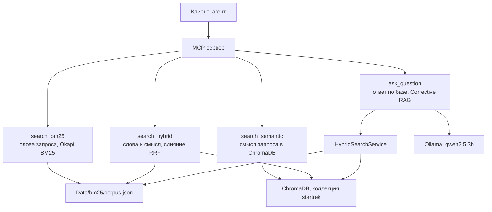
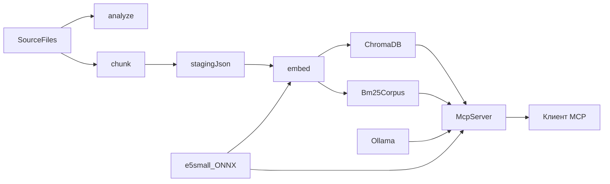

# RAG Knowledge Base: MCP-сервер с локальной LLM и Microsoft Semantic Kernel

Поиск по русскоязычному сериалу Star Trek на C# / .NET 10. 

Солюшен включает в себя:

- проект индексатора `src/StarTrek.Indexer` — консоль, которая режет `SourceFiles` по решёткам и считает локальные эмбеддинги `intfloat/multilingual-e5-small`;
- проект MCP-сервера `src/StarTrek.Mcp` — HTTP-сервер: три поиска по чанкам и инструмент `ask_question`, который отвечает через Corrective RAG;
- база ChromaDB — коллекция `startrek` с векторами чанков, файлы в папке `ChromaDB`;
- данные полнотекстового поиска — корпус Okapi BM25 в `Data/bm25/corpus.json`;
- локальная модель Ollama `qwen2.5:3b` — переписывает вопрос, оценивает чанки и пишет ответ. Эмбеддинги считает ONNX, не Ollama.

Python в решении нет. Подробности индексации — в [Docs/6. Plan.md](Docs/6.%20Plan.md). Запуск индексатора в Docker — в [Docs/7. План запуска в Docker.md](Docs/7.%20План%20запуска%20в%20Docker.md). Устройство сервера — в [Docs/8. Спецификация MCP-сервера.md](Docs/8.%20Спецификация%20MCP-сервера.md).

## Инструменты MCP



## Проверочные факты для MCP

- Как назывался вулканский корабль первого контакта?
- Кто родители Спока и в каком году он родился?
- Сурак
- Иные примеры вопросов в файле [Docs/5. Примеры вопросов.md](Docs/5. Примеры вопросов.md)

### Пример `ask_question`

Инструмент для вопроса о вселенной Star Trek, когда нужен ответ, а не список чанков. Вызов:

```json
{
  "name": "ask_question",
  "arguments": {
    "question": "Как назывался вулканский корабль первого контакта?"
  }
}
```

Факт, который обязан найтись в базе, а не в общих знаниях модели: корабль назывался **Т'Плана-Хат**. Файл: `SourceFiles/Races/Вулканцы.txt`.

Второй вопрос тем же инструментом: «Кто родители Спока и в каком году он родился?» В том же файле: **Сарек** и **Аманда Грейсон**, **2230** год, Вулкан.

Ответ выглядит так (формулировку пишет модель, имя и файл берутся из чанка):

```json
{
  "answer": "Вулканский корабль первого контакта назывался Т'Плана-Хат.",
  "sources": [
    {
      "sourceFile": "SourceFiles/Races/Вулканцы.txt",
      "position": "lines …"
    }
  ],
  "meta": {
    "rewrittenQuery": "вулканский корабль первого контакта",
    "query": "вулканский корабль первого контакта",
    "attempts": 1
  }
}
```

`position` зависит от нарезки. Проверяются имя корабля, родители Спока, год и `sourceFile`. Если в базе ничего релевантного нет, `answer` — «В базе знаний Star Trek об этом ничего не найдено.», `sources` пустой. Ollama не запущена, модель не скачана или ChromaDB не отвечает — инструмент возвращает ошибку текстом, процесс остаётся жив.


## Что нужно заранее установить

- **С Docker** — [Docker](https://www.docker.com/);
- **Без Docker** — SDK .NET 10;
- ONNX-модель `model.onnx` (~448 МБ): [скачать](https://huggingface.co/intfloat/multilingual-e5-small/resolve/main/onnx/model.onnx) в `Models/multilingual-e5-small/` (нужна для `embed` и для смыслового поиска);
- для `ask_question` — [Ollama](https://ollama.com/) и модель `qwen2.5:3b`. В Docker их поднимает Compose. Без Docker: `ollama serve` и `ollama pull qwen2.5:3b`.


## Запуск


### 1. Запуск индексатора

`health-check` и `help` не требуют ChromaDB; `embed` — требует (контейнер `startrek-chromadb`). `docker compose up` корпус не индексирует: у сервиса `indexer` по умолчанию `health-check`.

#### С Docker

SDK на хосте не нужен. Сборка образа `startrek-indexer`, `health-check` и запуск команд в контейнере — в [Docs/7. План запуска в Docker.md](Docs/7.%20План%20запуска%20в%20Docker.md).

#### Без Docker

Нужен SDK .NET 10.

```powershell
dotnet run --project src/StarTrek.Indexer -- <команда>
```


| Команда        | Что делает                                                                                                                                                                                                                                                                          |
| -------------- | ----------------------------------------------------------------------------------------------------------------------------------------------------------------------------------------------------------------------------------------------------------------------------------- |
| `analyze`      | Только печатает отчёт: файлы, уровни заголовков, пустые блоки, разделы длиннее 480 и короче 80 токенов (`--all` — показать все, а не первые 20). Ничего не пишет.                                                                                                                   |
| `chunk`        | Режет файлы по решёткам и пишет JSON в `Data/staging/` без векторов. Файлы с тем же `content_hash` пропускает (`--force` — переделать все). В ChromaDB ничего не кладёт.                                                                                                            |
| `embed`        | Читает `Data/staging/`, считает векторы e5 ONNX, пишет (upsert) чанки в коллекцию `startrek` и пересобирает индекс BM25 (корпус сохраняется в `Data/bm25/corpus.json`). Без модели или без ответа ChromaDB останавливается, уже записанное не трогает. `--force` — пересчитать всё. |
| `health-check` | Печатает `Индексатор отвечает: healthy.` и возвращает код 0. Не читает корпус, не грузит ONNX и не вызывает ChromaDB.                                                                                                                                                               |
| `help`         | Печатает список команд и завершается с кодом 0.                                                                                                                                                                                                                                     |


### 2. Запуск MCP-сервера

Сервис `mcp` — образ и контейнер `startrek-mcp`, порт `8080`. Сборка и запуск:

```powershell
docker compose build mcp
docker compose up -d chromadb ollama ollama-pull mcp
```

`docker compose up` по-прежнему не вызывает `analyze`, `chunk` и `embed`. Сервис `indexer` выполняет `health-check` и завершается. Сервис `mcp` остаётся слушать HTTP. Сервис `ollama-pull` скачивает `qwen2.5:3b` (около 2 ГБ) и завершается. Пока загрузка не кончилась, `ask_question` отвечает, что модель не загружена. Поиск тремя инструментами от Ollama не зависит.

Адрес клиента: `http://127.0.0.1:8080/mcp`.

Проверка процесса: `GET http://127.0.0.1:8080/health`. Ответ — код 200 и тело `MCP-сервер отвечает: healthy.` Этот запрос не читает корпус BM25, не грузит ONNX и не вызывает ChromaDB: строка значит, что процесс слушает, а не что индекс на месте. Проверка успешна и без корпуса, и без `model.onnx`.

Имена инструментов и куда они ходят — на схеме «Инструменты MCP» в начале файла.

Пример подключения — файл `mcp.example.json` в корне репозитория. Скопируйте его в `.vscode/mcp.json` для VS Code Copilot. Каталог `.vscode/` в git не входит. В примере адрес HTTP, не команда STDIO. 

## Модель эмбеддингов

`tokenizer.json` лежит в `Models/multilingual-e5-small/` и хранится в git. Это копия модели [intfloat/multilingual-e5-small](https://huggingface.co/intfloat/multilingual-e5-small). Откуда скачаны файлы и на каких правах они используются — в [Models/LICENSE.md](Models/LICENSE.md).

`Models/multilingual-e5-small/model.onnx` в git не входит: файл весит около 448 МБ. Скачайте его и сохраните по пути `Models/multilingual-e5-small/model.onnx`:

[https://huggingface.co/intfloat/multilingual-e5-small/resolve/main/onnx/model.onnx](https://huggingface.co/intfloat/multilingual-e5-small/resolve/main/onnx/model.onnx)

`analyze`, `chunk` и `health-check` работают без `model.onnx`: `chunk` нужен только `tokenizer.json` (подсчёт токенов), сам файл весов не вызывается.

При индексации E5 получает служебный префикс `passage:` , а при поисковом запросе — `query:` . В ChromaDB хранится текст без этого префикса. Эмбеддинги вычисляются локально, платный API не используется.

## ChromaDB

```powershell
docker compose up        # или: docker compose up -d
```

Compose поднимает пять сервисов. `docker compose up` корпус не индексирует:

- `chromadb` — образ `chromadb/chroma:1.5.9`, контейнер `startrek-chromadb`, порт `8000`, том `./ChromaDB:/data`;
- `indexer` — образ и контейнер `startrek-indexer`. По умолчанию выполняет только `health-check` и сразу завершается;
- `ollama` — контейнер `startrek-ollama`, порт `11434`, том `ollama-models`;
- `ollama-pull` — скачивает `qwen2.5:3b` и завершается;
- `mcp` — образ и контейнер `startrek-mcp`, порт `8080`. Слушает HTTP и отдаёт три инструмента поиска и `ask_question`. Сборка и адрес клиента — в разделе «2. Запуск MCP-сервера».

Локальный доступ к хранилищу:

- `http://127.0.0.1:8000` — локальный API ChromaDB на этом компьютере, а не сайт в интернете. Консоль отправляет в него команды «запиши чанк» и «найди ближайшие».
- Папка [ChromaDB](ChromaDB) — файлы хранилища, их пишет контейнер. C#-пакет эту папку напрямую не открывает: запись идёт только через API.

Консоль контейнер сама не запускает. Если API не отвечает, `embed` останавливается с сообщением, что ChromaDB не запущена.

## Схема




## Конфигурация

Всё настраивается в [src/StarTrek.Indexer/appsettings.json](src/StarTrek.Indexer/appsettings.json), а не в коде (отдельные значения можно переопределить переменными окружения с префиксом `STARTREK_`):

- `Indexer:Paths` — корпус, `Data/staging`, папка модели, файл корпуса BM25;
- `Indexer:Chroma` — адрес (`http://127.0.0.1:8000` локально; в Compose — `http://chromadb:8000`) и коллекция `startrek`;
- `Indexer:Chunking` — пороги 480 / 80 токенов и параметры переноса между кусками;
- `Indexer:Bm25` — `K1 = 1.5`, `B = 0.75`;
- `Indexer:Search` — параметры гибридного поиска (RRF).

Адрес, путь `/mcp`, журнал сервера, адрес Ollama, модель `qwen2.5:3b` и пороги Corrective RAG — в [src/StarTrek.Mcp/appsettings.json](src/StarTrek.Mcp/appsettings.json): `Rag:Ollama:Endpoint`, `Rag:Ollama:Model`, `Rag:MinRelevantChunks` (2), `Rag:MaxBroadenAttempts` (2), `Rag:RetrieveCount` (8). Тексты четырёх промптов — файлы в `src/StarTrek.Mcp/Prompts`. Пороги поиска сервер читает из файла индексатора. Переопределение — те же переменные `STARTREK_`, в Compose для Ollama это `STARTREK_Rag__Ollama__Endpoint=http://ollama:11434`.

Папки `Data/` и `ChromaDB/` хранятся в репозитории. Из `Models/` в git входит `tokenizer.json`; `model.onnx` скачивается отдельно.

## Поиск

Командной строки для поиска нет. Готовый индекс читает MCP-сервер:

- `search_bm25` — слова запроса в индексе Okapi BM25;
- `search_semantic` — смысл запроса в коллекции `startrek`;
- `search_hybrid` — оба списка, слияние RRF в `HybridSearchService`;
- `ask_question` — Corrective RAG: Rewrite, гибридный поиск, Grade, при нехватке релевантных чанков до двух раз Broaden, затем Generate. Ответ и список источников (файл и позиция чанка) пишет сервер. Граф описан в [ARCHITECTURE.md](ARCHITECTURE.md).

Три поиска возвращают чанки и ответ не сочиняют. `ask_question` вызывает, когда нужен готовый ответ по базе Star Trek.

## Тесты

```powershell
dotnet test
```

Проверяются `Tests/StarTrek.Indexer.Tests` и `Tests/StarTrek.Mcp.Tests`. Интеграционные тесты с живой ChromaDB пропускаются, если `http://127.0.0.1:8000` не отвечает.